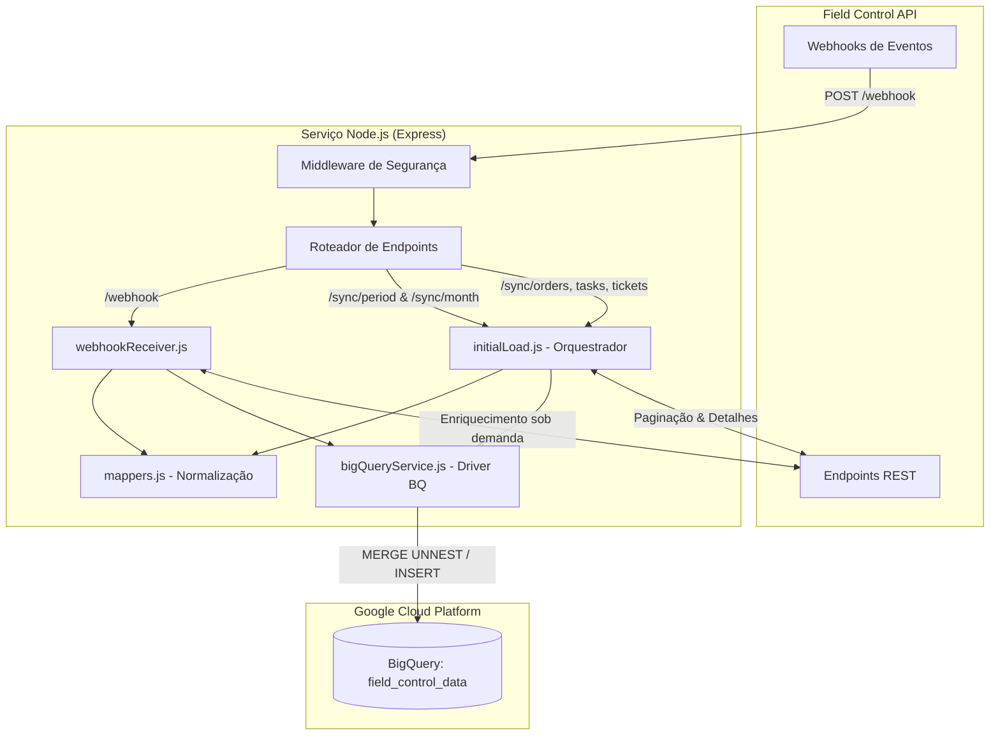

# Field Control → Google BigQuery Integration

Serviço de integração e ingestão contínua de dados da plataforma **Field Control** para o **Google BigQuery** (`bi-embratecc.field_control_data`, região `southamerica-east1`).

Projetado para operar em três modalidades complementares:
1. **Carga Histórica / Por Período Personalizado**: Ingestão retroativa por mês ou intervalo arbitrário de datas (`startDate` e `endDate`).
2. **Sincronização Delta / Incremental**: Polling das últimas X horas via filtros nativos de alteração (`updated_at>=:...`).
3. **Ingestão em Tempo Real (Event-Driven)**: Processamento e enriquecimento sob demanda via Webhooks.

---

## 🏛️ Arquitetura do Sistema



---

## 📋 Entidades Integradas (10 Entidades Mapeadas)

| # | Entidade | Tabela BigQuery | Chave Primária | Estratégia de Carga |
| :---: | :--- | :--- | :---: | :--- |
| **1** | **Serviços** | `services` | `id` | Carga de catálogo completa (`listAll`). |
| **2** | **Colaboradores** | `employees` | `id` | Carga de catálogo completa (`listAll`). |
| **3** | **Clientes** | `customers` | `id` | Paginação com filtro temporal (`created_at>=:`). Coleta IDs para filiais. |
| **4** | **Localidades** | `locations` | `id` | Consulta `/customers/{id}/locations` apenas dos clientes filtrados. |
| **5** | **Ordens de Serviço** | `orders` | `id` | Paginação (`updated_at>=:`), com enriquecimento individual de etiquetas (`labels`). |
| **6** | **Comentários de OS** | `order_comments` | `id` | Consulta sub-recursos `/orders/{id}/comments` das ordens do período. |
| **7** | **Anexos de OS** | `attachments` | `id` | Consulta sub-recursos `/orders/{id}/attachments` das ordens do período. |
| **8** | **Tarefas (Tasks)** | `tasks` | `id` | Paginação (`updated_at>=:`), com status, coordenadas e duração. |
| **9** | **Formulários** | `forms_answers`<br>`forms_answers_questions` | `id`<br>*(streaming)* | Detalha cabeçalhos e insere perguntas/respostas vinculadas. |
| **10** | **Tickets / Chamados** | `tickets` | `id` | Paginação com filtro temporal (`created_at>=:`). |
| **11** | **Avaliações** | `ratings` | *(streaming)* | Inserção direta no BigQuery via streaming buffer. |

---

## 🔒 Segurança e Otimizações Implementadas

1. **Prevenção de Injeção SQL no BigQuery**:
   * Implementada validação por lista branca (`ALLOWED_TABLES`) em [`services/bigQueryService.js`](file:///C:/Users/Rodrigo/dev/fieldcontrol/services/bigQueryService.js). Nenhuma tabela arbitrária pode ser interpolada em comandos SQL.
2. **Autenticação de Endpoints (Opcional por Token)**:
   * Suporte à variável `API_AUTH_TOKEN`. Quando definida, todas as rotas `/sync/*` e `/initial-load` exigem o cabeçalho `Authorization: Bearer <token>` ou `x-api-key: <token>`.
3. **Validação de Assinatura de Webhook**:
   * Suporte à variável `FIELD_CONTROL_WEBHOOK_SECRET` no cabeçalho `x-fieldcontrol-secret`.
4. **Proteção contra Concorrência (Mutex)**:
   * Bloqueio em memória (`getSyncStatus`) que impede múltiplos processos pesados de sincronização de rodarem ao mesmo tempo, respondendo `409 Conflict`.
5. **Upsert Nativo sem Staging**:
   * Atualização em lote via `MERGE INTO ... USING (SELECT * FROM UNNEST(@rows))` eliminando criação de tabelas temporárias e custos adicionais de DDL.
6. **Controle de Taxa Resiliente**:
   * Limitador de taxa (2 req/s) e concorrência máxima de 2 requisições, com backoff exponencial automático para erros `429 Too Many Requests`.

---

## ⚙️ Variáveis de Ambiente

Crie um arquivo `.env` na raiz do projeto baseado no `.env.example`:

```bash
# Credenciais da API Field Control
FIELD_CONTROL_API_KEY=sua_chave_aqui
FIELD_CONTROL_WEBHOOK_SECRET=segredo_opcional_webhook

# Google Cloud Platform / BigQuery
PROJECT_ID=bi-embratecc
GOOGLE_CLOUD_PROJECT=bi-embratecc
DATASET_ID=field_control_data
BIGQUERY_LOCATION=southamerica-east1

# Segurança da API Express (Opcional)
API_AUTH_TOKEN=seu_token_de_seguranca_aqui

# Configuração do Servidor
PORT=8080
```

---

## 🚀 Endpoints da API HTTP

### 1. Sincronização por Intervalo de Datas
```http
GET /sync/period?startDate=YYYY-MM-DD&endDate=YYYY-MM-DD&test=false
```
* **Headers**: `Authorization: Bearer <token>` (se `API_AUTH_TOKEN` estiver ativo).
* **Parâmetros**:
  * `startDate` *(obrigatório)*: Data inicial (ex: `2026-09-01`).
  * `endDate` *(opcional)*: Data final (ex: `2026-09-30`).
  * `test` *(opcional)*: Se `true`, limita a 10 registros por entidade para validação.

### 2. Sincronização por Mês Completo
```http
GET /sync/month?month=YYYY-MM&test=false
```
* **Exemplo**: `GET /sync/month?month=2026-09`

### 3. Atalho para Setembro de 2026
```http
GET /sync/september-2026
```

### 4. Status e Interrupção
* `GET /sync/status`: Retorna se há sincronização rodando e detalhes do período.
* `POST /sync/stop`: Envia sinal de interrupção para cancelar a carga em andamento.

### 5. Sincronizações Incrementais (Delta)
* `GET /sync/orders?hours=24`
* `GET /sync/tasks?hours=12`
* `GET /sync/tickets?hours=24`
* `GET /sync/all?hours=24`

### 6. Webhooks e Healthcheck
* `POST /webhook`: Endpoint para recepção de eventos da Field Control.
* `GET /health`: Healthcheck simples para monitoramento e balanceadores de carga.

---

## 💻 Execução via Linha de Comando (CLI)

O script [`functions/initialLoad.js`](file:///C:/Users/Rodrigo/dev/fieldcontrol/functions/initialLoad.js) pode ser executado diretamente pelo terminal:

```powershell
# Sincronizar por mês específico
node functions/initialLoad.js --month=2026-09

# Sincronizar por intervalo personalizado
node functions/initialLoad.js --startDate=2026-09-01 --endDate=2026-09-15

# Modo de teste (amostragem reduzida)
node functions/initialLoad.js --month=2026-09 --test

# Modo dry-run (apenas leitura, sem gravação no BigQuery)
node functions/initialLoad.js --month=2026-09 --dry-run
```

Ou através dos atalhos no `npm`:
```powershell
npm run sync:september
npm run sync:period -- --month=2026-08
```

---

## 🐳 Execução em Contêiner Docker

```powershell
# Construir imagem
docker build -t field-control-bi:latest .

# Executar contêiner
docker run -d -p 8080:8080 --env-file .env field-control-bi:latest
```

---

## ☁️ Implantação e Otimização de Custos (Google Cloud Run)

O serviço está configurado para máxima eficiência e mínimo custo no Cloud Run (`southamerica-east1`):

* **Dimensionamento**: `1 vCPU` / `1Gi` de memória (redução de 50% em relação a `2 vCPU / 2Gi`).
* **Escala Automática**: `minScale: 0` e `maxScale: 5`. Quando não há tráfego ou webhooks, o custo de instâncias ociosas é **zero**.
* **Startup CPU Boost**: Ativo para inicialização ultrarrápida (~1.5s) em cold starts.
* **Upsert BigQuery**: `MERGE ... UNNEST` em lotes de 100 a 500 registros, eliminando tabelas intermediárias de staging e minimizando custos de varredura.

